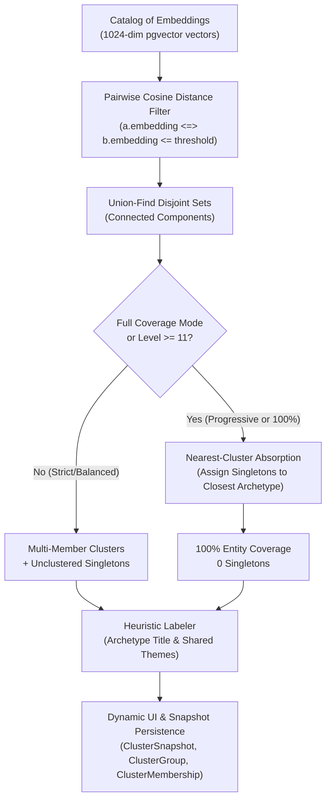

# Syncretica

Syncretica is a comparative mythology platform that explores syncretic archetype connections across world pantheons using high-dimensional vector embeddings, pgvector, and automated AI discovery agents.

---

## Embedding Clustering & Archetype Discovery

The `/clusters` engine discovers thematic archetypes by grouping deities (`God`) and mythological narratives (`Myth`) according to cosine similarity in vector embedding space.



---

## 1. How Core Clustering Works

### Vector Distance Metric
Syncretica uses cosine distance calculated via Postgres's `vector` extension (`pgvector`):
$$\text{Cosine Distance} = 1 - \text{Cosine Similarity} = 1 - \frac{u \cdot v}{\|u\| \|v\|}$$
In PostgreSQL with `pgvector`, the `<=>` operator computes cosine distance directly.

### Pairwise Distance Query
To find core archetype bonds without loading all 1,163 vectors into Ruby memory, the engine executes a filtered pairwise SQL self-join:

```sql
SELECT a.id, b.id
FROM gods a
JOIN gods b ON a.id < b.id
WHERE a.embedding IS NOT NULL
  AND b.embedding IS NOT NULL
  AND (a.embedding <=> b.embedding) <= :threshold;
```

- `a.id < b.id` prevents redundant symmetric pairs ($A, B$ vs $B, A$) and self-comparisons.
- `:threshold` is the maximum allowed cosine distance (e.g. `0.16` for tight twins, `0.22` for balanced archetypes).

### Connected Components (Union-Find)
Pairs meeting the distance cutoff are fed into a disjoint-set (Union-Find) algorithm with path compression. Transitive bonds merge into components:
- If God $A$ is close to God $B$ ($\le \text{threshold}$) and God $B$ is close to God $C$, they form a cluster $\{A, B, C\}$.
- Groups with $\ge 2$ members are classified as **Multi-Member Clusters**.
- Entities with no neighbors below the threshold remain as **Singletons** (unclustered).

---

## 2. Heuristic Grouping & Labeling

Each discovered cluster is automatically titled and summarized by `Clustering::HeuristicLabeler`:
1. **Shared Theme Extraction**: Aggregates the theme lists/hashes across all cluster members, filters out stop words, and ranks themes by frequency and specificity.
2. **Archetype Titling**:
   - Synthesizes an archetype domain title from top overlapping themes (e.g., *"Thunder & Sky Domain"*, *"Underworld & Judgment Domain"*).
   - If theme overlap is sparse, generates an eponymic title from prominent members (e.g., *"Zeus & Counterparts"*).
3. **Cross-Pantheon Badging**: Lists all distinct pantheons represented in the cluster (e.g., *Greek, Roman, Slavic, Etruscan, Thracian*).

---

## 3. Similarity Granularity Slider (Levels 1–15)

The interactive slider controls clustering sensitivity from strict counterparts down to complete catalog coverage:

| Level | Threshold ($\le$) | Mode | Typical Outcome |
| :---: | :---: | :--- | :--- |
| **1** | `0.16` | Strict Twins | Only near-identical counterpart deities (e.g., Greek & Roman twins). |
| **3** | `0.18` | Tight Archetypes | Close archetypal equivalents across immediate neighboring traditions. |
| **5** | `0.20` | Moderate | Balanced syncretic groups with tight domain focus. |
| **8** | `0.23` | Balanced Domains | Broad cross-pantheon archetypes (e.g. storm gods, sun gods, sea gods). |
| **10** | `0.25` | Broad Core | Largest core archetypes before graph chaining occurs. |
| **11** | `0.24` | 25% Absorption | Absorbs the closest 25% of singletons into nearest clusters. |
| **12** | `0.24` | 50% Absorption | Absorbs the closest 50% of singletons into nearest clusters. |
| **13** | `0.24` | 75% Absorption | Absorbs the closest 75% of singletons into nearest clusters. |
| **14** | `0.23` | 90% Absorption | Absorbs the closest 90% of singletons into nearest clusters. |
| **15** | `0.22` | **100% Full Coverage** | **0 unclustered singletons**: all 1,163 entities mapped to clean archetypes. |

---

## 4. Full Coverage & Zero-Singleton Mode

### The Problem: Single-Linkage Chaining vs. Isolated Singletons
In high-dimensional embedding spaces, deities are distributed across a continuous semantic manifold:
- At strict thresholds ($\le 0.22$), isolated deities (e.g., obscure local spirits or highly idiosyncratic figures) lack neighbors within distance $0.22$, resulting in several hundred singletons.
- If one simply expands the raw pairwise threshold to $\ge 0.35$ or $0.48$, the "chaining effect" causes intermediate nodes to bridge disparate clusters, collapsing almost all 1,163 deities into **one giant megacluster**.

### The Solution: Nearest-Cluster Absorption
When the user toggles **Full Coverage (0 Singletons)** or moves to **Level 15**, Syncretica uses a two-stage approach:
1. **Core Formation**: Detects clean, compact, non-chained archetype clusters using an optimal core threshold ($\le 0.22$–$0.24$).
2. **Intelligent Absorption**: For every isolated singleton, finds its closest member among existing clusters and absorbs the singleton into that cluster:

```sql
WITH clustered AS (
  SELECT id, embedding
  FROM gods
  WHERE id IN (:clustered_ids)
)
SELECT
  s.id AS singleton_id,
  (
    SELECT c.id
    FROM clustered c
    ORDER BY s.embedding <=> c.embedding
    LIMIT 1
  ) AS nearest_clustered_id,
  (
    SELECT (s.embedding <=> c.embedding)
    FROM clustered c
    ORDER BY s.embedding <=> c.embedding
    LIMIT 1
  ) AS distance
FROM gods s
WHERE s.id IN (:singleton_ids)
ORDER BY distance ASC;
```

### Result:
- **0 Unclustered Singletons** (100% of deities or myths belong to an archetype).
- **~140 balanced, distinct archetype clusters** (e.g., Zeus, Jupiter, Taranis, and Tinia in *Sky & Thunder Domain*).
- **No giant megaclusters** (the largest cluster is ~90–100 items instead of 1,163).

---

## 5. Snapshot Persistence & Report Generation

Clicking **Save Snapshot** records the clustering state into relational database tables:

- **`cluster_snapshots`**: Master record containing `target_type` (`God` or `Myth`), `level`, `distance_threshold`, `clusters_count`, `items_count`, and custom `title`.
- **`cluster_groups`**: Individual cluster groups belonging to the snapshot (`name`, `shared_themes`, `size`).
- **`cluster_memberships`**: Polymorphic join table linking each `cluster_group` to `God` or `Myth` records.

### Querying Snapshots for Reports
Saved snapshots can be inspected under `/cluster_snapshots` or queried via ActiveRecord / SQL for automated report generation:

```ruby
# Find the latest full-coverage snapshot for Gods
snapshot = ClusterSnapshot.for_target("God").ordered.first

# Iterate over archetypes by size
snapshot.cluster_groups.by_size.each do |group|
  puts "#{group.name} (#{group.size} members):"
  puts "  Shared themes: #{group.shared_themes.join(', ')}"
  puts "  Deities: #{group.cluster_memberships.includes(:record).map { |m| m.record.name }.join(', ')}"
end
```

---

## Development & Test Suite

### Requirements
- Ruby 3.4+
- PostgreSQL 16+ with `vector` extension (`pgvector`)
- Redis (for Sidekiq background jobs)

### Running Tests
Execute the comprehensive test suite (including model, service, and controller tests):

```bash
bin/rails test
```

### Running Rubocop
```bash
bin/rubocop
```
