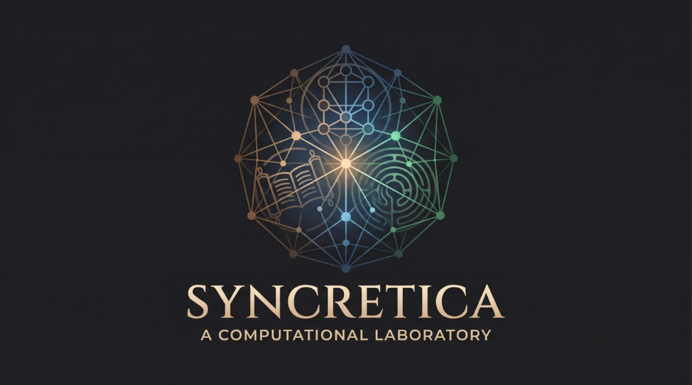
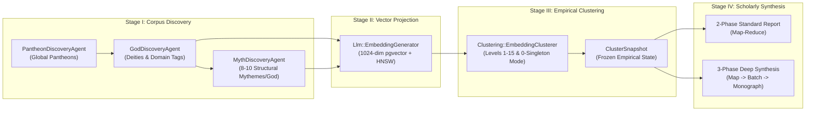
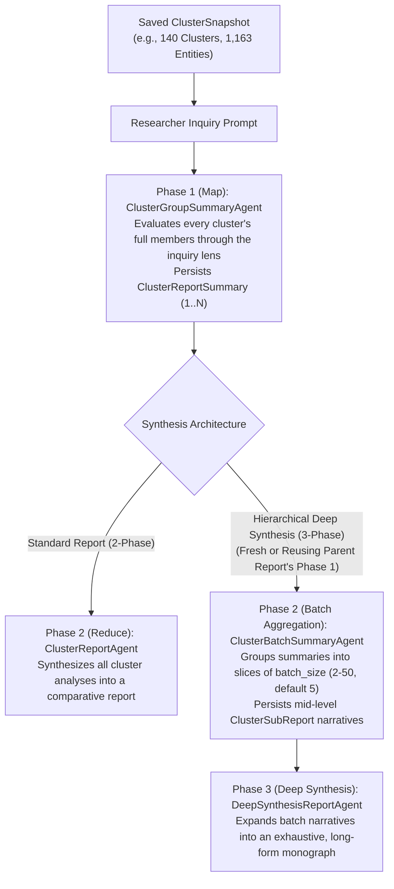
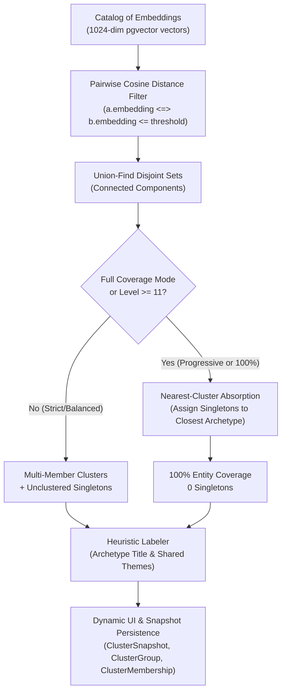
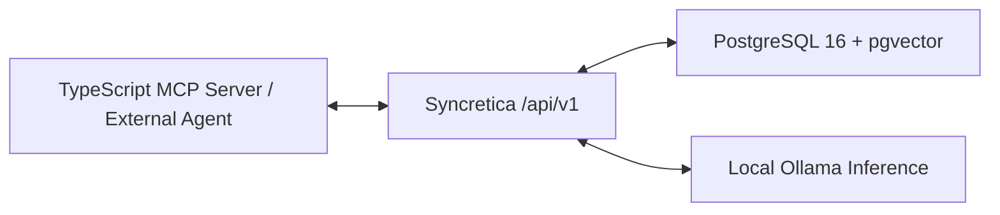

<p align="center">
  
</p>

# Syncretica: A Computational Laboratory for Comparative Mythology, Historical Theology, and Cognitive Archaeology

[](https://www.ruby-lang.org/)
[](https://rubyonrails.org)
[](https://www.postgresql.org/)
[](https://github.com/pgvector/pgvector)
[](https://ollama.com)
[](https://github.com/flavorjones/ruby-llm)
[](https://sidekiq.org)
[](https://tailwindcss.com)
[](https://hotwired.dev)
[](LICENSE)

**Syncretica** is an open-source digital humanities and computational research platform designed for **theologians**, **comparative religionists**, **archaeologists**, and **mythologists**. It enables scholars to systematically map, cluster, and synthesize syncretic archetypes, structural *mythemes*, and cross-cultural religious parallels across world pantheons using **1024-dimensional semantic vector embeddings (`pgvector`)**, **graph-theoretic connected components**, and **multi-stage AI synthesis pipelines**.

---

## Abstract & Scholarly Vision

For over a century, comparative religion and historical archaeology have grappled with a foundational methodological tension: how can scholars compare thousands of deities, ritual epithets, and mythological narratives across global traditions without either losing local cultural specificity or succumbing to cherry-picked, anecdotal parallels?

Classical structuralist and comparative frameworks (such as **Claude Lévi-Strauss's** structural decomposition of myths into constituent bundles of relations (*mythemes*), **Georges Dumézil's** trifunctional hypothesis of sovereignty, martial force, and fertility, **Mircea Eliade's** morphology of the sacred (*hierophanies*), and archaeological models of **trans-regional trade syncretism (*interpretatio*)**) offered profound theoretical lenses, yet were historically constrained by the human limits of manual corpus indexing.

**Syncretica** operationalizes these comparative frameworks in a transparent, reproducible, and locally hosted computational laboratory:

1. **Multi-Tier Corpus Construction**: Automated scholarly discovery agents populate a structured relational catalog of global **Pantheons**, **Deities (`God`)**, thematic domain tags, and 8–10 decomposed **Mythological Themes (`Myth`)** per deity.
2. **High-Dimensional Semantic Manifold**: Every deity profile and mythological theme bundle is projected into a **1024-dimensional vector space** indexed via PostgreSQL `pgvector` HNSW (`vector_cosine_ops`), allowing empirical measurement of semantic proximity across disparate cultures.
3. **Multi-Granularity Empirical Clustering & Snapshotting**: Researchers interactively tune cosine distance thresholds across **15 granularity levels** (from strict historical twins at *Level 1, $\le 0.16$* to zero-singleton **100% Full Catalog Coverage** at *Level 15* via a two-stage core-and-absorption algorithm that prevents single-linkage megacluster collapse) and freeze states into immutable **Cluster Snapshots**.
4. **Map-Reduce & Hierarchical Deep Synthesis Reports**: Rather than relying on shallow single-prompt summaries, Syncretica executes a **2-Phase Map-Reduce** or **3-Phase Hierarchical Deep Synthesis** workflow over saved snapshots, inspecting every cluster through the scholar's specific research inquiry and grounding every claim in cited cluster numbers, deities, and pantheons.

---

## Table of Contents

1. [Why Install Syncretica? Dual Disciplinary Research Tracks](#1-why-install-syncretica-dual-disciplinary-research-tracks)
   - [For Theologians & Comparative Religionists](#11-for-theologians--comparative-religionists)
   - [For Archaeologists & Material Culture Specialists](#12-for-archaeologists--material-culture-specialists)
2. [End-to-End Empirical Research Pipeline](#2-end-to-end-empirical-research-pipeline)
   - [Stage I: Multi-Tier Corpus Discovery (`/`, `/gods`, `/myths`)](#stage-i-multi-tier-corpus-discovery--gods-myths)
   - [Stage II: High-Dimensional Semantic Embedding (`/settings`)](#stage-ii-high-dimensional-semantic-embedding-settings)
   - [Stage III: Interactive Archetype Clustering & Snapshots (`/clusters`, `/cluster_snapshots`)](#stage-iii-interactive-archetype-clustering--snapshots-clusters-cluster_snapshots)
   - [Stage IV: Multi-Stage Scholarly Report Synthesis (`/reports`)](#stage-iv-multi-stage-scholarly-report-synthesis-reports)
3. [Computational Methodology: Vector Clustering & Zero-Singleton Absorption](#3-computational-methodology-vector-clustering--zero-singleton-absorption)
   - [Vector Distance Metric & Pairwise SQL Filter](#31-vector-distance-metric--pairwise-sql-filter)
   - [Connected Components (Union-Find) & Heuristic Labeling](#32-connected-components-union-find--heuristic-labeling)
   - [Similarity Granularity Slider (Levels 1–15)](#33-similarity-granularity-slider-levels-115)
   - [Full Coverage & Zero-Singleton Mode (Nearest-Cluster Absorption)](#34-full-coverage--zero-singleton-mode-nearest-cluster-absorption)
   - [Programmatic Snapshot Persistence & ActiveRecord Queries](#35-programmatic-snapshot-persistence--activerecord-queries)
4. [Installation & Local Laboratory Setup for Researchers](#4-installation--local-laboratory-setup-for-researchers)
5. [Your First Cross-Cultural Investigation (4-Step Lab Walkthrough)](#5-your-first-cross-cultural-investigation-4-step-lab-walkthrough)
6. [Programmatic REST API (`/api/v1`) & MCP Server Integration](#6-programmatic-rest-api-apiv1--mcp-server-integration)
7. [Open Science, Reproducibility, Testing & Academic Citation](#7-open-science-reproducibility-testing--academic-citation)

---

## 1. Why Install Syncretica? Dual Disciplinary Research Tracks

Syncretica runs 100% locally on your workstation using open-weights language and embedding models via Ollama and PostgreSQL `pgvector`. There are no proprietary API paywalls, rate limits, or opaque cloud mutations, making your empirical snapshots and synthesized monographs reproducible and auditable.

### 1.1 For Theologians & Comparative Religionists

Theological and history-of-religions inquiry often examines how diverse civilizations conceptualize divine sovereignty, cosmic order, moral law, suffering, and eschatology. Syncretica allows theologians to test structural hypotheses across the entire catalog ($1,163+$ deities and mythologies):

- **Structural Mytheme Decomposition**: In the `/myths` catalog, each deity's narrative corpus is decomposed into 8–10 formal thematic propositions (e.g., for Zeus: *"Breaking the Generational Curse"*, *"Cosmic Order vs. Primordial Chaos"*, *"Justice and Civic Moral Law (Themis and Dike)"*, *"Submission to Fate (Moira)"*). Clustering on `Myth` vectors groups narratives by **structural theology** rather than surface nomenclature.
- **Trifunctional & Sovereign Typologies**: Test Dumézilian partitions (magical-juridical vs. martial vs. pastoral-agrarian deities) both within Indo-European traditions (Vedic, Greek, Roman, Norse, Slavic, Celtic, Hittite) and across non-Indo-European systems (Yoruba, Mesopotamian, Egyptian, Mesoamerican, Shinto).
- **Theodicy, Fate, and Divine Limit**: Investigate how supreme sky or creator deities across cultures negotiate cosmic law, predestination, and mortal hubris.

> [!TIP]
> **Sample Theological Research Inquiries (Copy & Paste into a Snapshot Report):**
> - *"Analyze how supreme sky and sovereign deities across clusters negotiate the boundary between omnipotence and submission to cosmic law or fate (e.g., Moira, Rta, Ma'at, Wyrd). Which non-Mediterranean pantheons exhibit the closest structural parallels?"*
> - *"Examine the 'Cosmic Order vs. Primordial Chaos' (Chaoskampf) motif across the clustered mythologies. Contrast dragon/serpent-slaying sovereignty myths with non-violent cosmogonies through speech, sacrifice, or craftsmanship."*
> - *"Trace the theological convergence of underworld judgment, psychopomp functions, and agrarian rebirth across clusters. Where do chthonic judges overlap with fertility deities?"*

### 1.2 For Archaeologists & Material Culture Specialists

Archaeologists frequently confront fragmentary material evidence (such as unlabeled votive reliefs, syncretic frontier inscriptions, cylinder seals, or newly excavated cultic assemblages) where the functional identity or trans-regional affiliation of a local deity is contested:

- **Contextualizing Regional & Frontier Cults (*Interpretatio*)**: By sweeping the `/clusters` granularity slider from **Level 1 (`0.16`)** to **Level 8 (`0.23`)**, archaeologists can observe exactly when a regional deity (e.g., Etruscan *Tinia*, Gallo-Roman *Taranis*, Thracian or Anatolian figures) merges into a broader Mediterranean or Near Eastern semantic cluster.
- **Cultural Diffusion vs. Independent Cognitive Convergence**:
  - **High Similarity + Documented Trade/Migration Corridor** (e.g., Levantine–Aegean Bronze Age networks, Hellenistic–Bactrian Silk Road, Circum-Caribbean exchange) provides quantitative support for **historical syncretism and diffusion**.
  - **High Similarity Across Geographically Isolated Pantheons** (e.g., Andean, Polynesian, and Baltic solar or metallurgical deities clustering tightly at Level 5) isolates **independent ecological or cognitive convergence**, helping cognitive archaeologists model universal human responses to metallurgy, agriculture, celestials, and mortality.
- **Outlier & Idiosyncrasy Detection**: Comparing strict core clusters (**Levels 1–10**) against absorbed singletons (**Levels 11–15**) immediately highlights which deities possess unique, culturally idiosyncratic ritual profiles that resist standard cross-cultural typologies.

> [!TIP]
> **Sample Archaeological Research Inquiries (Copy & Paste into a Snapshot Report):**
> - *"Compare clusters containing Bronze Age Near Eastern, Anatolian, and Aegean deities (Mesopotamian, Canaanite, Hittite, Minoan/Mycenaean, Greek, Egyptian). Which functional domains, such as metallurgy, maritime storm, sacred kingship, or threshold warfare, show the tightest vector clustering indicative of Eastern Mediterranean trade-route syncretism?"*
> - *"Identify cross-continental clusters where Mesoamerican/Andean deities group tightly with Old World counterparts. Analyze whether these convergences center on shared ecological/subsistence substrates (maize/grain cycles, solar calendars, obsidian/metallurgical craft) or funerary stratification."*
> - *"Isolate the peripheral singletons absorbed at Granularity Levels 11–15. Which localized cult figures or specialized tutelary spirits resist assimilation into dominant pan-regional archetypes, and what material or ecological niches do they occupy?"*

---

## 2. End-to-End Empirical Research Pipeline

Syncretica structures cross-cultural investigation into a four-stage empirical pipeline:



### Stage I: Multi-Tier Corpus Discovery (`/`, `/gods`, `/myths`)

1. **Pantheon Discovery (`/`)**: `PantheonDiscoveryAgent` surveys historical, classical, and indigenous traditions across the globe, generating canonical pantheon records (`Pantheon`) with geographic and thematic descriptions while deduplicating against existing entries.
2. **Deity Discovery (`/gods`)**: For each pantheon, `GodDiscoveryAgent` populates major and regional deities (`God`), capturing each figure's canonical name, mythological role/attributes, and an array of $2\text{--}6$ thematic domain motifs (e.g., `["sky", "thunder", "kingship"]`).
3. **Structural Mytheme Synthesis (`/myths`)**: For each deity, `MythDiscoveryAgent` synthesizes $8\text{--}10$ scholarly mytheme propositions stored as a JSONB map (`Myth#themes`) pairing an evocative structural title with a single rigorous sentence explaining how that motif manifests in the deity's cult and narrative cycle.

### Stage II: High-Dimensional Semantic Embedding (`/settings`)

Via the `/settings` laboratory console (or per-record actions), `Llm::EmbeddingGenerator` encodes every `God` and `Myth` into a **1024-dimensional floating-point vector** (`vector(1024)`) using a dedicated Ollama embedding context (`qwen3-embedding:0.6b` by default) and indexes them using PostgreSQL `pgvector` HNSW indices (`vector_cosine_ops`).

Researchers can also configure the **LLM Context Window** (`32K`, `64K`, `128K`, `256K`, `512K`, up to `1M` tokens) in `/settings`, which dynamically scales the character budget (`Llm::ModelRegistry.digest_char_budget`) allocated to downstream synthesis agents.

### Stage III: Interactive Archetype Clustering & Snapshots (`/clusters`, `/cluster_snapshots`)

On `/clusters`, researchers toggle between **Gods** and **Myths**, adjust the **Similarity Granularity Slider (Levels 1–15)** or **Full Coverage (0 Singletons)** mode, inspect individual deities and mythemes via **in-page detail modals** without losing scroll position, and click **Save Snapshot** to persist the exact partition (`ClusterSnapshot`, `ClusterGroup`, `ClusterMembership`) into PostgreSQL.

### Stage IV: Multi-Stage Scholarly Report Synthesis (`/reports`)

Once a `ClusterSnapshot` is saved, researchers can pose any custom academic inquiry (or select a preset analytical prompt) to generate a publication-ready Markdown report. To overcome LLM attention degradation across $140+$ clusters and $1,163+$ entities, Syncretica implements two distinct multi-stage synthesis architectures in `GenerateClusterReportJob`:



1. **2-Phase Standard Comparative Report (Map-Reduce)**:
   - **Phase 1: Inquiry-Guided Cluster Analysis (Map)**: `ClusterGroupSummaryAgent` iterates through every `ClusterGroup` in the snapshot, inspecting its full member descriptions, pantheons, and themes specifically through the lens of the researcher's prompt, persisting each analysis as a `ClusterReportSummary`.
   - **Phase 2: Cross-Cluster Synthesis (Reduce)**: `ClusterReportAgent` synthesizes the per-cluster findings into a structured comparative report complete with executive summary, explicit citations of cluster numbers (`Cluster #1`, `Cluster #12`), named deities/pantheons, structural outliers, and theoretical conclusions.
2. **3-Phase Hierarchical Detailed Report (Deep Synthesis)**:
   - Designed for exhaustive, monograph-scale investigations where compressing $140+$ clusters in a single final pass would truncate nuanced regional evidence.
   - **Phase 1 Reuse Optimization**: When launched from an existing completed report (`POST /reports/:id/deep_synthesis`), Syncretica **copies and reuses** all Phase 1 `ClusterReportSummary` records (`ClusterReport#copy_summaries_from!`), advancing immediately to Phase 2 without redundant LLM inference.
   - **Phase 2: Mid-Level Batch Aggregation**: `ClusterBatchSummaryAgent` partitions the ordered cluster summaries into batches of configurable size (`batch_size` $2\text{--}50$, default $5$) and synthesizes each slice into a detailed intermediate narrative (`ClusterSubReport`).
   - **Phase 3: Deep Monograph Synthesis**: `DeepSynthesisReportAgent` expands the batch-level narratives into a comprehensive, long-form scholarly study, maintaining a bidirectional link to its parent report.

---

## 3. Computational Methodology: Vector Clustering & Zero-Singleton Absorption

The `/clusters` engine discovers thematic archetypes by grouping deities (`God`) and mythological narratives (`Myth`) according to cosine similarity in vector embedding space.



### 3.1 Vector Distance Metric & Pairwise SQL Filter

Syncretica uses cosine distance calculated via PostgreSQL's `vector` extension (`pgvector`):

$$\text{Cosine Distance} = 1 - \text{Cosine Similarity} = 1 - \frac{u \cdot v}{\|u\| \|v\|}$$

In PostgreSQL with `pgvector`, the `<=>` operator computes cosine distance directly. To discover core archetype bonds without loading all $1,163$ vectors into Ruby memory, `Clustering::EmbeddingClusterer` executes a filtered pairwise SQL self-join:

```sql
SELECT a.id, b.id
FROM gods a
JOIN gods b ON a.id < b.id
WHERE a.embedding IS NOT NULL
  AND b.embedding IS NOT NULL
  AND (a.embedding <=> b.embedding) <= :threshold;
```

- `a.id < b.id` prevents redundant symmetric pairs ($A, B$ vs. $B, A$) and self-comparisons.
- `:threshold` specifies the maximum allowed cosine distance (e.g., `0.16` for strict twins, `0.22` for balanced archetypes).

### 3.2 Connected Components (Union-Find) & Heuristic Labeling

Pairs meeting the distance cutoff are fed into a disjoint-set (**Union-Find**) algorithm with path compression and union by rank. Transitive bonds merge into connected components:
- If Deity $A$ is within threshold of Deity $B$ ($\le \text{threshold}$) and Deity $B$ is within threshold of Deity $C$, they form a connected component $\{A, B, C\}$.
- Components with $\ge 2$ members are classified as **Multi-Member Clusters**.
- Entities with no neighbors below the threshold remain as **Singletons** (unclustered).

Each discovered cluster is automatically titled and summarized by `Clustering::HeuristicLabeler`:
1. **Shared Theme Extraction**: Aggregates theme lists/hashes across all cluster members, filters stop words, and ranks themes by document frequency and specificity.
2. **Archetype Titling**: Synthesizes an archetype domain title from top overlapping themes (e.g., *"Thunder & Sky Domain"*, *"Underworld & Judgment Domain"*), or falls back to an eponymic title from prominent members (e.g., *"Zeus & Counterparts"*).
3. **Cross-Pantheon Badging**: Catalogs all distinct pantheons represented in the cluster (e.g., *Greek, Roman, Slavic, Etruscan, Thracian*).

### 3.3 Similarity Granularity Slider (Levels 1–15)

The interactive slider controls clustering sensitivity from strict historical counterparts down to complete catalog coverage:

| Level | Threshold ($\le$) | Mode | Typical Scholarly Outcome |
| :---: | :---: | :--- | :--- |
| **1** | `0.16` | Strict Twins | Only near-identical counterpart deities (e.g., direct Greek & Roman *interpretatio* twins). |
| **3** | `0.18` | Tight Archetypes | Close archetypal equivalents across immediate neighboring traditions. |
| **5** | `0.20` | Moderate | Balanced syncretic groups with tight ritual or thematic focus. |
| **8** | `0.23` | Balanced Domains | Broad cross-pantheon archetypes (e.g., storm gods, solar deities, maritime gods). |
| **10** | `0.25` | Broad Core | Largest core archetypes before single-linkage graph chaining occurs. |
| **11** | `0.24` | 25% Absorption | Absorbs the closest 25% of singletons into their nearest core clusters. |
| **12** | `0.24` | 50% Absorption | Absorbs the closest 50% of singletons into their nearest core clusters. |
| **13** | `0.24` | 75% Absorption | Absorbs the closest 75% of singletons into their nearest core clusters. |
| **14** | `0.23` | 90% Absorption | Absorbs the closest 90% of singletons into their nearest core clusters. |
| **15** | `0.22` | **100% Full Coverage** | **0 unclustered singletons**: all $1,163$ entities mapped to clean archetypes. |

### 3.4 Full Coverage & Zero-Singleton Mode (Nearest-Cluster Absorption)

#### The Methodological Problem: Single-Linkage Chaining vs. Isolated Singletons
In high-dimensional embedding spaces, religious concepts and deities are distributed across a continuous semantic manifold:
- At strict thresholds ($\le 0.22$), highly localized tutelary spirits or idiosyncratic figures lack neighbors within distance $0.22$, leaving several hundred unclustered singletons.
- If a researcher naively expands the raw pairwise threshold to $\ge 0.35$ or $0.48$, the **single-linkage chaining effect** causes polyvalent intermediate deities (e.g., gods combining sky, war, healing, and magic) to bridge disparate clusters, collapsing almost all $1,163$ deities into **one giant megacluster**.

#### The Solution: Two-Stage Core Formation & Nearest-Cluster Absorption
When the researcher enables **Full Coverage (0 Singletons)** or selects **Level 15**, Syncretica executes a two-stage partition:
1. **Core Formation**: Identifies compact, non-chained archetype clusters using an optimal core cutoff ($\le 0.22\text{--}0.24$).
2. **Nearest-Cluster Absorption**: For every remaining singleton, executes a nearest-neighbor query against all clustered entities and absorbs the singleton into its closest cluster without allowing absorbed singletons to chain two distinct core clusters together:

```sql
WITH clustered AS (
  SELECT id, embedding
  FROM gods
  WHERE id IN (:clustered_ids)
)
SELECT
  s.id AS singleton_id,
  (
    SELECT c.id
    FROM clustered c
    ORDER BY s.embedding <=> c.embedding
    LIMIT 1
  ) AS nearest_clustered_id,
  (
    SELECT (s.embedding <=> c.embedding)
    FROM clustered c
    ORDER BY s.embedding <=> c.embedding
    LIMIT 1
  ) AS distance
FROM gods s
WHERE s.id IN (:singleton_ids)
ORDER BY distance ASC;
```

#### Empirical Outcome:
- **0 Unclustered Singletons** (100% of deities or myths are assigned to an archetype).
- **$\sim 140$ balanced, distinct archetype clusters** (e.g., Zeus, Jupiter, Taranis, and Tinia in *Sky & Thunder Domain*).
- **Zero megacluster collapse** (the largest cluster remains $\sim 90\text{--}100$ items rather than $1,163$).

### 3.5 Programmatic Snapshot Persistence & ActiveRecord Queries

Clicking **Save Snapshot** records the empirical partition into relational database tables:
- **`cluster_snapshots`**: Master record storing `target_type` (`God` or `Myth`), `level`, `distance_threshold`, `clusters_count`, `items_count`, and custom `title`.
- **`cluster_groups`**: Individual archetype clusters belonging to the snapshot (`name`, `shared_themes`, `size`).
- **`cluster_memberships`**: Polymorphic join table linking each `cluster_group` to `God` or `Myth` records.

Researchers comfortable with Ruby or SQL can also inspect snapshots and reports programmatically via `bin/rails console`:

```ruby
# Retrieve the latest full-coverage snapshot for Gods
snapshot = ClusterSnapshot.for_target("God").ordered.first

# Iterate over discovered archetypes by size
snapshot.cluster_groups.by_size.each do |group|
  puts "#{group.name} (#{group.size} members):"
  puts "  Shared themes: #{group.shared_themes.join(', ')}"
  puts "  Deities: #{group.cluster_memberships.includes(record: :pantheon).map { |m| "#{m.record.name} (#{m.record.pantheon.name})" }.join(', ')}"
end
```

---

## 4. Installation & Local Laboratory Setup for Researchers

Syncretica is built with **Ruby on Rails 8.1**, **PostgreSQL (`pgvector`)**, **Redis / Sidekiq**, and **RubyLLM** connected to a local **Ollama** server. Follow the steps below to install the laboratory on macOS or Linux.

### Step 1: System Prerequisites

Ensure the following services are installed and running on your workstation:

1. **Ruby `3.4.3+`** (via `rbenv`, `asdf`, `mise`, or Homebrew)
2. **PostgreSQL `16+`** with the **`pgvector`** extension installed:
   - *macOS (Homebrew)*: `brew install postgresql@16 pgvector && brew services start postgresql@16`
   - *Ubuntu/Debian*: `sudo apt install postgresql-16 postgresql-16-pgvector`
3. **Redis `7+`** (powers Sidekiq background workers for corpus discovery, vector embedding, and multi-stage report synthesis):
   - *macOS (Homebrew)*: `brew install redis && brew services start redis`
   - *Ubuntu/Debian*: `sudo apt install redis-server && sudo systemctl enable --now redis-server`
4. **Ollama** (or any OpenAI-compatible local inference server such as vLLM / LM Studio exposing `/v1`):
   - Download from [ollama.com](https://ollama.com) and start the local server (`ollama serve`).

### Step 2: Pull Local Open-Weights Models

Pull the 1024-dimensional embedding model and your preferred generative scholarly model in Ollama:

```bash
# 1. Required 1024-dimensional semantic embedding model (default)
ollama pull qwen3-embedding:0.6b

# 2. Generative model for corpus discovery and comparative report synthesis
# (You may use Qwen3, Llama 3.3, DeepSeek, Gemma 3, or any capable open-weights model)
ollama pull qwen3:32b
```

### Step 3: Clone & Configure Environment

Clone the repository and create your `.env` file from `.env.example`:

```bash
git clone https://github.com/leouofa/syncretica.git
cd syncretica
cp .env.example .env
```

Edit `.env` to match your local Ollama model and endpoints:

```dotenv
# Primary Ollama-compatible endpoint and model for discovery & report synthesis
OLLAMA_API_BASE=http://localhost:11434/v1
OLLAMA_MODEL=Qwen3.6-35B-A3B-NVFP4

# Background job queue
REDIS_URL=redis://localhost:6379/0

# Optional overrides for the 1024-dim embedding generator (defaults shown)
# EMBEDDING_API_BASE=http://localhost:11434/v1
# EMBEDDING_MODEL=qwen3-embedding:0.6b
```

### Step 4: Bootstrap the Database & Verify LLM Connectivity

Run the automated setup script to install Ruby gems and prepare the PostgreSQL `pgvector` schema, then run the built-in LLM verification task:

```bash
# Install dependencies and create/migrate the PostgreSQL database
bin/setup --skip-server

# Verify database model registration and live Ollama connectivity
bin/rails llm:verify
```

A successful check will output:

```text
Configured endpoint: http://localhost:11434/v1
Configured model:    Qwen3.6-35B-A3B-NVFP4
Registered DB model: ollama/Qwen3.6-35B-A3B-NVFP4 (id=1)
Live response:       OK
Verification passed!
```

### Step 5: Launch the Research Environment

Start the web server, Tailwind CSS watcher, and Sidekiq background worker together:

```bash
bin/dev
```

Open **[http://localhost:3000](http://localhost:3000)** in your browser. (In development, you can also monitor background jobs live at **[http://localhost:3000/sidekiq](http://localhost:3000/sidekiq)**.)

---

## 5. Your First Cross-Cultural Investigation (4-Step Lab Walkthrough)

Once your local server is running at `http://localhost:3000`, follow this four-step workflow to conduct an end-to-end comparative study:

1. **Populate the Global Corpus (`/`, `/gods`, `/myths`)**:
   - On the **Pantheons** home page (`/`), click **Populate Pantheons** to dispatch `PopulatePantheonsJob`.
   - Navigate to **Gods** (`/gods`) and click **Populate Gods** to discover deities and thematic domain tags across all cataloged pantheons.
   - Navigate to **Myths** (`/myths`) and click **Populate Myths** to synthesize 8–10 structural mytheme propositions for every deity.
2. **Generate 1024-d Vector Embeddings & Set Context Budget (`/settings`)**:
   - Open **Settings** (`/settings`).
   - Select your model's **Context Window** preset (`32K` to `1M` tokens).
   - Click **Generate All Missing Embeddings** for both **Gods** and **Myths** to populate the `pgvector` HNSW indices.
3. **Explore Semantic Clusters & Capture an Empirical Snapshot (`/clusters`)**:
   - Open **Clusters** (`/clusters`) and select either **Gods** or **Myths**.
   - Drag the **Granularity Slider** between **Level 1** (Strict Twins) and **Level 15** (100% Full Coverage / 0 Singletons) to observe how archetypes coalesce across cultures. Click any deity or myth badge to inspect its full description, domains, and mythemes in an in-page modal.
   - Enter a descriptive title (e.g., *"Full-Coverage Global Mytheme Partition (Level 15)"*) and click **Save Snapshot**.
4. **Synthesize Comparative & Hierarchical Deep Reports (`/cluster_snapshots` $\rightarrow$ `/reports`)**:
   - On your saved snapshot page, enter a theological or archaeological research inquiry (or choose a preset lens) and click **Generate Report** to launch the **2-Phase Map-Reduce** analysis. Watch real-time progress via Turbo Streams as each cluster is analyzed.
   - Once completed, review the synthesized report on `/reports/:id`. To expand the investigation into an exhaustive monograph without re-running Phase 1 cluster analyses, choose a batch size ($2\text{--}50$, default $5$) and click **Generate Detailed Report** to execute the **3-Phase Hierarchical Deep Synthesis**.

---

## 6. Programmatic REST API (`/api/v1`) & MCP Server Integration

Syncretica exposes a full JSON REST API under `/api/v1` accompanied by a native **OpenAPI 3.1 specification** (`GET /api/v1/openapi.json`), designed to be consumed by external applications, automated research agents, and companion **Model Context Protocol (MCP)** servers.



### Core API Capabilities
- **Platform Health & Introspection**: `GET /api/v1/status` and `GET /api/v1/openapi.json`.
- **Global Cross-Resource Search**: `GET /api/v1/search?q=...&mode=semantic|keyword`.
- **Pantheons**: Full CRUD, batch upsert, and LLM discovery triggers (`/api/v1/pantheons`).
- **Deities (`God`)**: CRUD, batch upsert, theme/pantheon filtering, semantic vector search, nearest-neighbor similarity (`/api/v1/gods/:id/neighbors`), and embedding generation.
- **Mythological Themes (`Myth`)**: CRUD, proposition search, nearest structural neighbors, and embedding generation (`/api/v1/myths`).
- **Clustering & Snapshots**: On-the-fly live cluster calculation (`GET /api/v1/clusters`) and snapshot creation/inspection (`/api/v1/cluster_snapshots`, `/api/v1/cluster_groups`).
- **Multi-Stage Synthesis Reports**: Initiate 2-Phase Map-Reduce and 3-Phase Hierarchical Deep Synthesis monographs (`/api/v1/cluster_reports`), with granular access to Phase 1 cluster summaries and Phase 2 batch sub-reports.
- **Job Status Tracking**: Inspect and poll async background discovery and embedding jobs (`GET /api/v1/jobs/:id`) or execute single-record actions synchronously via `?sync=true`.
- **LLM Settings**: Dynamically inspect and tune the model context window and embedding generation (`/api/v1/settings`).

For detailed documentation, request/response JSON schemas, and TypeScript MCP integration code examples, see the complete guide:

👉 **[REST API Reference Manual (`docs/api.md`)](docs/api.md)**

---

## 7. Open Science, Reproducibility, Testing & Academic Citation

### Auditability & Provenance
Unlike black-box chat interfaces, Syncretica persists the complete provenance chain of every empirical run in PostgreSQL:
- Every vector carries its `embedding_model` identifier and `embedded_at` timestamp.
- Every `ClusterSnapshot` preserves the exact `level`, `distance_threshold`, `ClusterGroup` boundaries, and `ClusterMembership` links.
- Every `ClusterReport` preserves its Phase 1 per-cluster analyses (`cluster_report_summaries`), Phase 2 mid-level batch narratives (`cluster_sub_reports`), parent-child synthesis lineage (`parent_report_id`), and underlying LLM `chats` and `messages`.

### Running the Automated Test Suite & Linter

```bash
# Execute the full unit, service, job, and controller test suite
bin/rails test

# Run RuboCop style and static analysis checks
bin/rubocop
```

### Citing Syncretica in Academic Publications

If you use Syncretica to discover cross-cultural parallels, test archaeological diffusion vs. convergence models, or generate comparative theological syntheses in your research, please cite the software and include your snapshot parameters (`target_type`, `level`, `distance_threshold`, `embedding_model`, and generative `model_id`):

```bibtex
@software{syncretica2026,
  title        = {Syncretica: A Computational Laboratory for Comparative Mythology, Historical Theology, and Cognitive Archaeology},
  author       = {Syncretica Contributors},
  year         = {2026},
  url          = {https://github.com/leouofa/syncretica},
  note         = {High-dimensional pgvector archetype clustering and hierarchical LLM synthesis platform}
}
```
